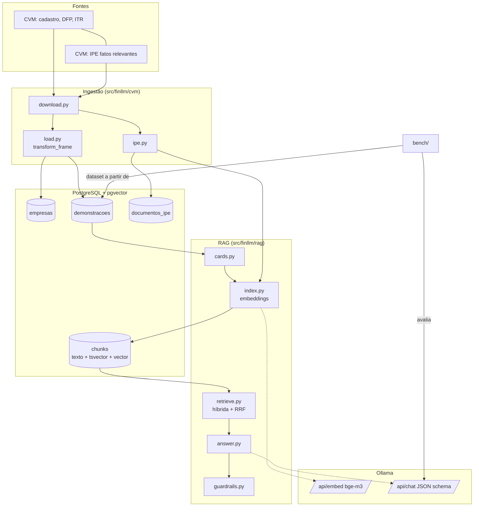

# 01 · Arquitetura

## Visão em camadas

## Fluxos

**Indexação (offline)**
1. `cvm download` → `data/raw/…` (zips/CSVs).
2. `cvm load` → `empresas` e `demonstracoes` (valores em reais, última versão, só exercício corrente).
3. `rag index-statements` → `cards.py` agrupa linhas por (empresa, doc, demonstração, consolidação, período), renderiza texto e quebra em chunks repetindo o cabeçalho → `index.py` calcula embeddings (`bge-m3`) e grava em `chunks` (idempotente por hash).
4. `cvm ipe-sync` + `rag index-ipe` → documentos narrativos: download → texto (PDF/HTML) → chunks → embeddings.

**Consulta (online)** — `rag ask`
1. `retrieve`: detecta empresa (`entities.py`) e anos na pergunta → filtros; busca vetorial + FTS pt-BR → fusão RRF → top-k. Sem resultado com filtro ⇒ refaz sem filtro.
2. `answer`: prompt com trechos numerados + JSON schema (`Resposta`) → Ollama.
3. `guardrails`: todo número da resposta deve existir no contexto; se não, **1 retry** com feedback; persistindo, o aviso é mostrado ao usuário.

## Modelo de dados (resumo)

| Tabela | Chave | Observações |
|---|---|---|
| `empresas` | `cd_cvm` | nome, CNPJ, setor, situação |
| `demonstracoes` | (sem unique; recarga idempotente por delete+insert) | `vl_conta` em **reais**; `tipo_doc` DFP/ITR; `consolidacao` con/ind |
| `documentos_ipe` | `doc_id` = protocolo-versão | `status`: pendente/indexado/ignorado/erro |
| `chunks` | `content_hash` único | `tsv` (gerado) + `embedding vector(EMBED_DIM)`; índices HNSW (cosseno) e GIN |

## Decisões (ADRs)
[0001 Ollama local](adr/0001-ollama-local.md) · [0002 pgvector + busca híbrida](adr/0002-pgvector-busca-hibrida.md) · [0003 números determinísticos](adr/0003-numeros-deterministicos.md) · [0004 httpx em vez de SDK](adr/0004-httpx-em-vez-de-sdk.md) · [0005 cartões](adr/0005-cartoes-de-demonstracoes.md)

## Pontos de extensão
- Novo motor (técnico): módulo próprio que expõe funções determinísticas; o LLM as consome via *tool calling* (o benchmark já testa essa capacidade).
- Trocar modelo de embeddings: ajuste `EMBED_MODEL`/`EMBED_DIM`, recrie `chunks` e reindexe.
- Trocar o provedor LLM: o cliente fala a API nativa do Ollama; para outro provedor, implemente a mesma interface de `OllamaClient.chat/embed`.
